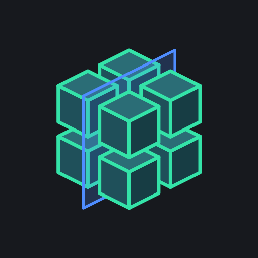
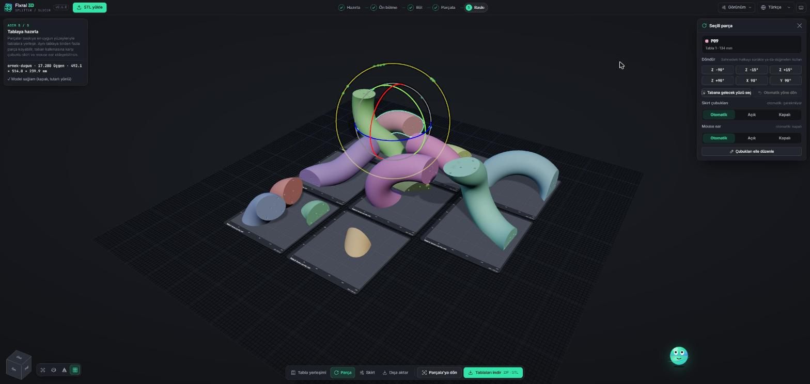
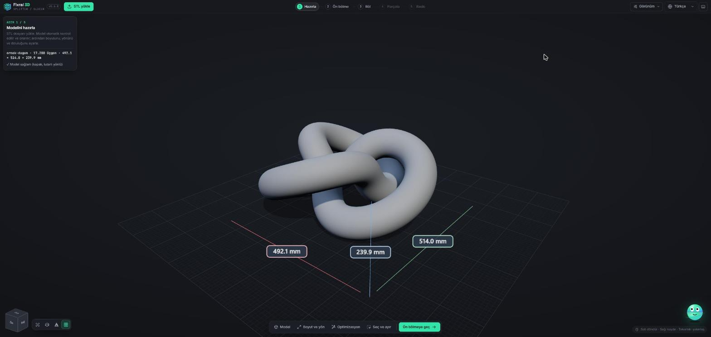
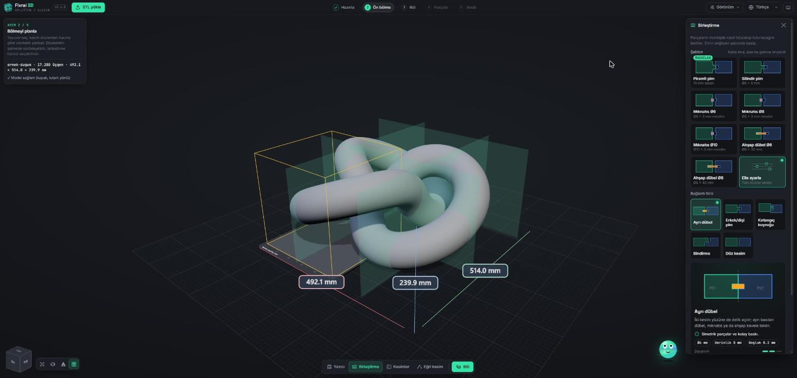
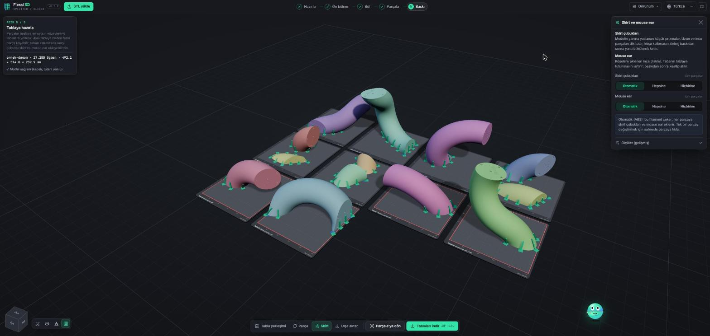
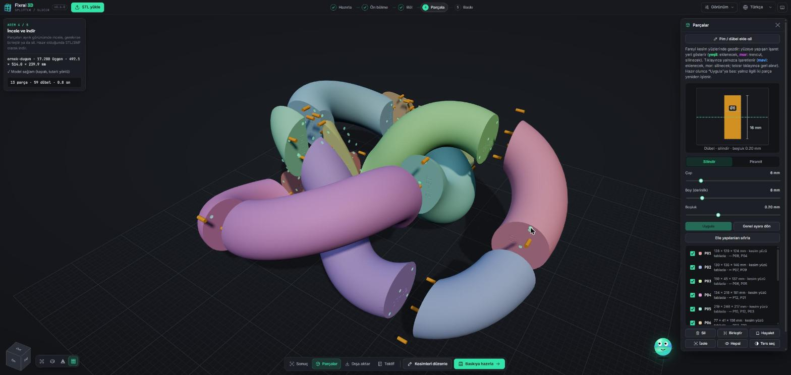
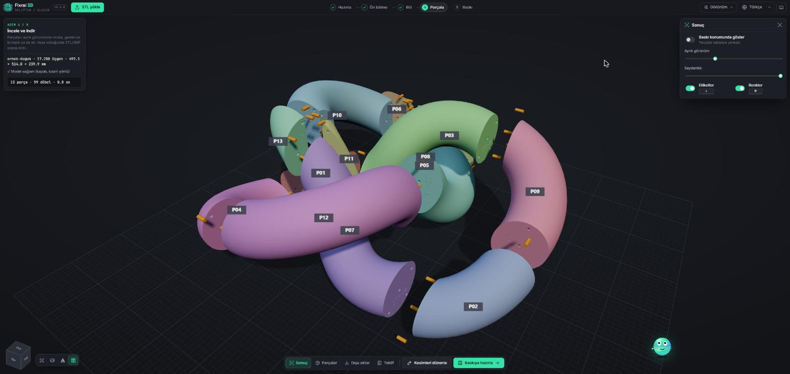
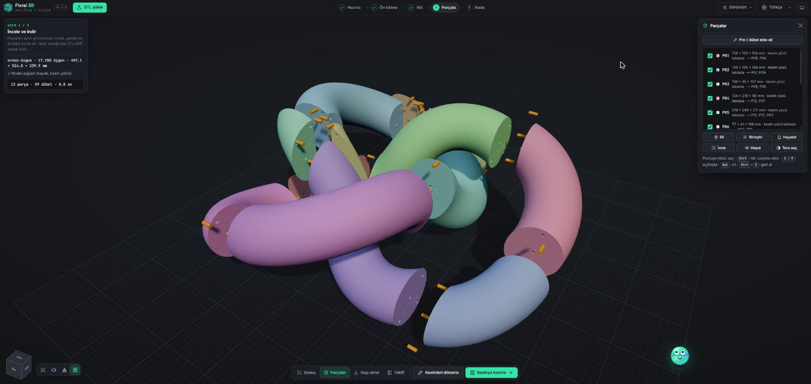
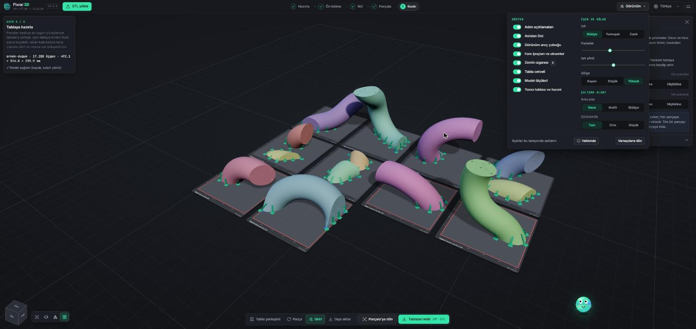
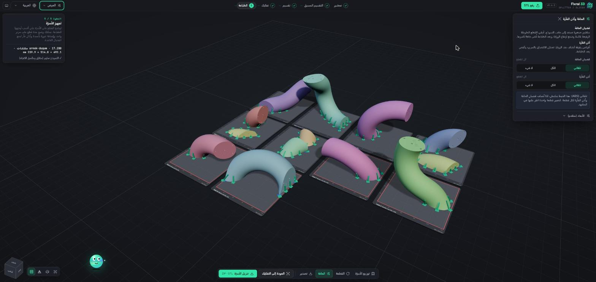

# Fixral 3D Splitter / Slicer

**Büyük 3D modelleri yazıcına sığdır.** Ücretsiz, tarayıcıda çalışan 3D model bölme (STL splitter) aracı: STL modelini yazıcının baskı hacmine göre böl; pim, dübel, mıknatıs, ahşap kavela, kırlangıç kuyruğu, bindirme ya da ince plakalar için kelebek kamayla birleştir; numaralı parçaları yazıcının tablalarına yerleştirip STL ya da 3MF olarak indir.

**Fit oversized 3D models on your printer.** A free, in-browser 3D model splitter: cut STL files to your build volume, join them with pins, dowels, magnets, dovetails or lap joints, lay the numbered parts out on your printer's plates and export STL or 3MF.

### [▶ Canlı uygulamayı aç / Open the live app](https://fixral3d.github.io/fixral-3d-splitter/)

---

## Neden Fixral?

- **Kurulum yok, hesap yok:** Bağlantıyı aç ve kullan. Bilgisayar, tablet ya da telefonda çalışır.
- **Dosyan senin:** Model hiçbir sunucuya yüklenmez. Tüm geometri işlemleri tarayıcında, WebAssembly ile yapılır.
- **Baskıya hazır sonuç:** Parçalar tablaya sığacak yönde döndürülür, numaralanır ve yazıcının tablalarına yerleştirilir; birleşecekleri parçanın numarası kesim yüzüne oyulur.
- **27 yazıcı modeli, 10 dil:** Bambu Lab, Prusa, Creality, Elegoo, Anycubic, Sovol, Qidi, Flashforge ya da özel ölçü; arayüz ve sesli asistan seçtiğin dilde.

## Nasıl çalışır?

| Adım | Ne yapar? |
|---|---|
| **1 · Hazırla** | STL, 3MF, OBJ, GLB ya da PLY'i sürükle, ya da .fixral projeni aç. Sahnede yalnız model ve ölçüleri: otomatik mesh onarımı, sadeleştirme, ölçekleme (`850mm`, `120%`, `1.5`), döndürme, aynalama, içini boşaltma. |
| **2 · Ön bölme** | Yazıcı modelini seç; tablası (marka, ölçü, mm cetveli) ve kesim düzlemleri gelir. Birleştirme şablonunu seç; düzlemleri sürükle, kesim ekle ya da sil, düzlemi açılı kesime çevir ya da eğri kesim çiz. |
| **3 · Böl** | Parçalar ve bağlantılar arka planda saniyeler içinde üretilir; ilerleme ekranın ortasında görünür. |
| **4 · Parçala** | Parçaları ayrık görünümde incele, birleştir, sil; kesim yüzüne pim, dübel ya da kama ekle, işarete tıklayıp sil. ZIP veya 3MF olarak indir. |
| **5 · Baskı** | Parçalar tablaya sığan en uygun yönle tablalara yerleşir; bir ya da birkaç parçayı döndür ya da tabana gelecek yüzü seç; basılan dübel ve kamalar da tablalara gelir; gerekiyorsa skirt ve mouse ear'ı tıklayarak ya da seçili parçalara toplu ekle; tabla başına STL ya da çok tablalı 3MF. |

## v0.13.0'da yeni

- **Doğal ek yerleri:** tek tıkla kol, bacak, baş ve kulp gibi uzantılar boyun ve eklem yerlerinden ayrılır; modelin geri kalanı kesilmez, ek yerine pim ya da dübel gelir. Yazıcıya sığan uzuvlar ayrılınca gövde gereksiz yere kesilmez.
- **Renkler korunur:** renkli 3MF, GLB, OBJ ve PLY modeller rengini kaybetmeden bölünür; parçalar kendi renkleriyle görünür, renkli 3MF olarak iner.

## v0.12.0'da yeni

- **Proje dosyası ve kurtarma:** çalışmanı `.fixral` olarak kaydet; sayfa kapanırsa açılışta kaldığın yerden devam et. STL'e ek olarak 3MF, OBJ, GLB ve PLY açılır; "Baskıya uygun hale getir" bozuk ya da iç içe kabuklu modelleri düzeltir.
- **Bölmeden önce gör:** pim, dübel, kırlangıç, kelebek kama ve bindirme kesim düzlemlerinde önizlenir; yoğunluk (Az / Orta / Çok) ve modele göre otomatik ölçü.
- **Daha çok bağlantı:** altıgen, D profil (tek yönde takılır), geçmeli ve bilyalı eklem; her kesimde pim tarafı seçilir; tolerans deneme parçası.
- **Eğri modeller için:** açılı kesim artık her bağlantıyla çalışır, iki eksende döner; "Kesimleri modele dik hizala" kıvrık kirişlerde kesimi modele dik koyar; çoklu çizgi kesim.
- **Montaj:** takılabilir sıra ve adım adım görüntülü, yazdırılabilir montaj kılavuzu; drenaj deliği aracı; kavisli yüzeylere de parça numarası.

## v0.11.0'da yeni

- **Dübel ve kamalar tablada:** basılan dübeller ve kelebek kamalar baskı tablalarına adedince yerleşir ve tablalarla birlikte STL ya da 3MF olarak iner.
- **Geri al / yinele her adımda:** alt çubuktaki düğmeler ya da `Ctrl`+`Z` / `Ctrl`+`Y`; kesimler, parça silme ve birleştirme, bağlantı düzenleme ve baskı yerleşimi geri alınır.
- **Kesim ekle, sil, açıyla döndür:** istediğin eksene kesim ekle; düzleme tıklayıp sil ya da bir eksen etrafında istediğin açıyla eğ.

## v0.10.0'da yeni

- **İnce plakalar için kelebek kama:** kesim çizgisinin ortasına iki parçaya eşit giren bir cep açılır; plaka kalınlığında, ayrı basılan kama içine oturup parçaları kilitler. Sivri (kelebek) ya da damla (oval) uçlu: parça kesim yüzü tablada basılsa da cep köprüsüz, desteksiz çıkar. Kamalar otomatik yerleşir; genişlik, uzunluk ve boyun ayarlanır, yerleri tıklayarak eklenip silinir.
- **Skirt ve mouse ear isteğe bağlı:** hiçbir parçaya kendiliğinden eklenmez. Herhangi bir parçaya tek tıkla tek ear ya da çubuk ekle, ya da seçili parçalara toplu ekle/kaldır.
- **Daha güvenilir elle bağlantı düzenleme:** pim/dübel işaretine tıklayınca silinir; kenara ya da başka bağlantıya çok yakın yer kırmızı gösterilir ve eklenmez.

## v0.9.0'da yeni

- **Uygulama gibi kullan:** "Uygulamayı yükle" ile ana ekrana ya da masaüstüne ekle; tam ekran açılır, bir kez açtıktan sonra internetsiz de çalışır. iPhone/iPad'de Safari'nin "Paylaş → Ana Ekrana Ekle" adımları gösterilir.
- **Sakin baskı ekranı:** sahne tıklaması için araç seç: `Seç · Döndür · Ear · Çubuk`. Döndürme yalnız Döndür aracında; ear ve çubuk eklemek ya da döndürmek tablaları yeniden dizmez, parça yerinde kalır. İstersen "Tablalara yeniden yerleştir".
- **Yeni Dot** ve **yeni örnek model:** ekran yüzlü küçük robot asistan; örnek olarak burgulu bir vazo.

## v0.8.0'da yeni

- **Daha net iş akışı:** beş ana adım alttaki çubukta, her adımın araçları sağ kenardaki rayda. İlk kullanımda Dot bakılacak araçları sayar, henüz açmadıkların yeşil noktayla işaretlenir.
- **Çoklu seçimle döndürme:** baskı adımında `Ctrl`+tık ya da "Tümünü seç" ile birkaç parçayı birlikte döndür.
- **Mouse ear'ı fareyle yerleştir:** parçayı seç, kenarına ya da yanındaki tablaya tıkla; 1, 4 ya da hiç, sayı senin seçimin. Skirt çubukları da tablaya tıklayarak eklenir.

## v0.7.0'da yeni

- **Tam ekran çalışma alanı:** sabit panel yok; altta adımın araçları, ayarlar sağ kenardaki panelde, model ortada açık. Sol altta kamerayla dönen görünüm küpü.
- **Yazıcı tablası ve 27 güncel yazıcı:** seçtiğin yazıcının tablası sahnede marka/model adı, ölçüsü ve mm cetveliyle çizilir; baskı tablaları da aynı şekli alır.
- **Seçili parça aracı:** baskı adımında parçaya tıkla; Z'de ±15°/±90° döndür, X/Y'de yatır ya da sahnedeki halkayla döndür; tabana gelecek düz yüzü seçerek tablaya oturt.
- **Tablaya kesin sığan yerleşim** ve **tabla başına tek model olan 3MF:** dilimleyicide açılınca her model kendi tablasında.
- **İnce parçalarda da numara:** etiket eğik yazılır, kısaltılır ya da parçanın düz dış yüzüne oyulur.
- **Sade skirt ve mouse ear ayarı:** tüm parçalar için `Otomatik | Hepsine | Hiçbirine`, parça başına ayrı seçim.
- **Yeni logo ve yükleniyor göstergesi:** parçalara ayrılıp birleşen küp.

## Öne çıkan özellikler

### Tablalara yerleşen, döndürülebilen parçalar
Her parça için tabla teması büyük, sarkması az ve tablaya kesin sığan yön seçilir; parçalar seçili yazıcının tablalarına dağıtılır. Bir parçaya tıklayıp düğmelerle ya da sahnedeki halkayla döndür, istersen tabana gelecek yüzü seç.

### Yüzeyi izleyen skirt çubukları ve mouse ear
ABS, ASA, naylon ve PC gibi çeken filamentlerde taban ve köşe kalkmasına karşı: tabladaki taban plakasının üstünde duran üçgen prizma modele hafifçe değer ve eğimli yüzeylerde yüzeyin açısına göre eğilir; baskıdan sonra yana bükerek kırılır. 8 filament profili (PLA, PETG, ABS, ASA, TPU, PA, PC, PLA-CF).

### Kesitin şeklini izleyen bağlantılar
Pim, dübel, mıknatıs ve kırlangıç kuyruğu noktaları kesit boyunca, kalın bölgelere yakın ve aralıklı dağılır. Kesim yüzüne tıklayarak elle pim ya da dübel ekle; her noktanın çapı, boyu ve tipi ayrı ayarlanır.

### Numaralı parçalar
Kesim yüzlerine oyulan `03-07` etiketi: bu yüz P03'e ait ve P07 ile birleşir. İnce parçalarda numara eğik yazılır ya da düz bir dış yüze oyulur.

### Ayrık görünüm ve parça araçları
Parçaları ayrık görünümde incele; birleştir, sil, gizle, izole et, geri al. Tahmini teklif (filament, süre, malzeme, makine, montaj, hazırlık, kâr) ve yazdırılabilir montaj kılavuzu.

### Görünüm menüsü
Adım açıklamaları, asistan, zemin ızgarası, tabla cetveli, ölçüler, yazıcı tablası; ışık, gölge, arka plan ve çözünürlük. Tercihler tarayıcında saklanır.

### Konuşan asistan Dot ve 10 dil
Dot seçtiğin dilde sesli anlatım yapar, rehberli tur verir ve "bu adımda ne yapmalıyım?" sorusunu yanıtlar. Arayüz Türkçe, English, Deutsch, 中文, 日本語, 한국어, العربية (sağdan sola), Français, Italiano ve Español dillerinde.

### Diğerleri
Eğri kesim · akıllı seç ve ayır (kulak, burun gibi detaylar) · ince şerit bırakmayan kesim optimizasyonu · içini boşaltma ve kesimlere dolu bölme · kesit ve tel kafes görünümü · STL, 3MF ve ZIP dışa aktarma.

## Desteklenen yazıcılar

Bambu Lab X1 Carbon / X1E, P1S / P1P, P2S, A1, A1 mini, H2D, H2S · Prusa MK4S / MK4, Core One, MINI+, XL · Creality K1 / K1C, K1 Max, K2 Plus, Hi, Ender-3 V3 / V3 SE / V3 KE · Elegoo Centauri Carbon, Neptune 4 Pro, Neptune 4 Max · Anycubic Kobra 3, Kobra S1 · Sovol SV06, SV08 · Qidi Q1 Pro, Plus4 · Flashforge Adventurer 5M / 5M Pro · özel ölçü.

## Dil bağlantıları

[Türkçe](https://fixral3d.github.io/fixral-3d-splitter/?lang=tr) ·
[English](https://fixral3d.github.io/fixral-3d-splitter/?lang=en) ·
[Deutsch](https://fixral3d.github.io/fixral-3d-splitter/?lang=de) ·
[中文](https://fixral3d.github.io/fixral-3d-splitter/?lang=zh) ·
[日本語](https://fixral3d.github.io/fixral-3d-splitter/?lang=ja) ·
[한국어](https://fixral3d.github.io/fixral-3d-splitter/?lang=ko) ·
[العربية](https://fixral3d.github.io/fixral-3d-splitter/?lang=ar) ·
[Français](https://fixral3d.github.io/fixral-3d-splitter/?lang=fr) ·
[Italiano](https://fixral3d.github.io/fixral-3d-splitter/?lang=it) ·
[Español](https://fixral3d.github.io/fixral-3d-splitter/?lang=es)

## Anahtar kelimeler / Keywords

3D model bölme · STL bölme · 3D baskı için model bölme · büyük model bölme · pim · dübel · mıknatıs · kırlangıç kuyruğu · bindirme · baskı hacmi · tabla yerleşimi · mouse ear · skirt · ücretsiz · tarayıcıda

3D model splitter · STL splitter · split STL online · split 3D model for printing · oversized 3D model · pin joint · dowel joint · magnet joint · dovetail joint · lap joint · build volume · plate layout · multi-plate 3MF · anti-warping skirt · mouse ears · mesh repair · free · browser-based

---

## English

**Fixral 3D Splitter / Slicer** splits oversized STL models to fit your 3D printer's build volume, entirely in your browser. No install, no account, and your file never leaves your computer: all geometry runs locally with WebAssembly.

- **Full-screen workspace:** the five main steps in a bottom bar, each step's tools in a right-side rail with a settings panel, a first-run guide, view cube, a centred progress card for long operations
- **27 printer models** (Bambu Lab, Prusa, Creality, Elegoo, Anycubic, Sovol, Qidi, Flashforge) or a custom size, with the printer's bed drawn in the scene
- **Joints:** pyramid or cylinder pins, separate dowels, neodymium magnet pockets, wooden dowels, dovetails, lap joints and butterfly keys for thin plates (a separately printed key as thick as the plate, with ends that print without supports), placed along each cross-section
- **Model prep:** automatic mesh repair, simplification, scaling, rotation, mirroring, hollowing, smart select & extract
- **Numbered parts** with engraved `03-07` mating labels, also on thin parts
- **Installable app:** add to your home screen or desktop, full screen, works offline after the first visit
- **Print step:** orientation that always fits the bed, a click tool (Select, Rotate, Ear, Rod) so nothing moves unless you ask, rotate one or several parts (buttons or a drag ring), pick the bed face, optional skirt rods and mouse ears added one at a time by clicking or in bulk to the selected parts, 8 filament profiles
- **Export:** STL (ZIP), colored 3MF, per-plate STL and a multi-plate 3MF with one model per plate
- **Built-in quote** and a printable assembly guide
- **Dot**, a talking assistant with a guided tour, in 10 languages including right-to-left Arabic

**[▶ Open the live app](https://fixral3d.github.io/fixral-3d-splitter/?lang=en)**

---

Bu depo yalnızca canlı sitenin derlenmiş dosyalarını barındırır; kaynak kodu paylaşılmamaktadır.
This repository only hosts the built files of the live site; the source code is not public.

**Fixral 3D Splitter / Slicer v0.7.0** · [Canlı uygulama / Live app](https://fixral3d.github.io/fixral-3d-splitter/) · [fixral.com](https://fixral.com) · [fixral3d@gmail.com](mailto:fixral3d@gmail.com)

© 2026 Fixral. Tüm hakları saklıdır. All rights reserved.
