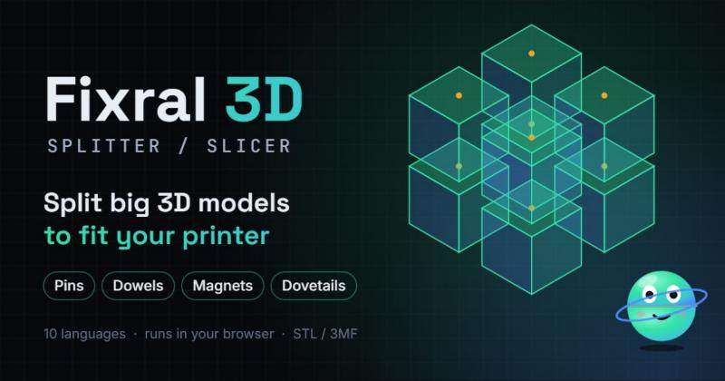
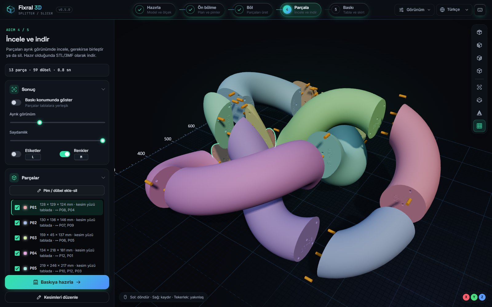
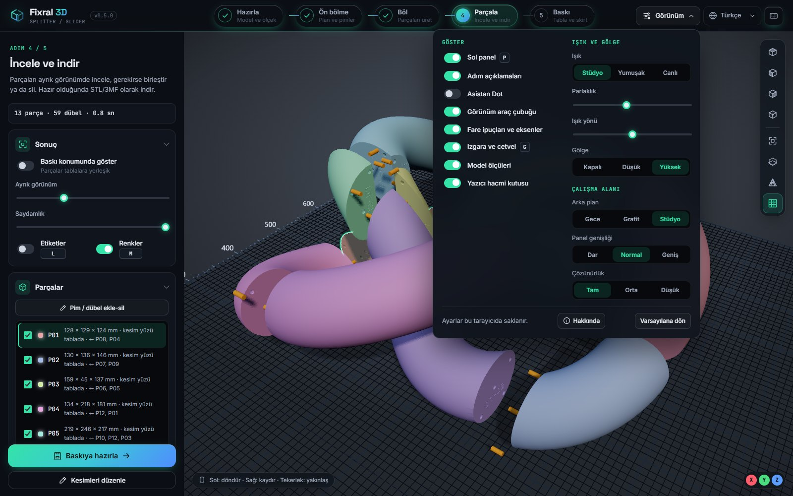
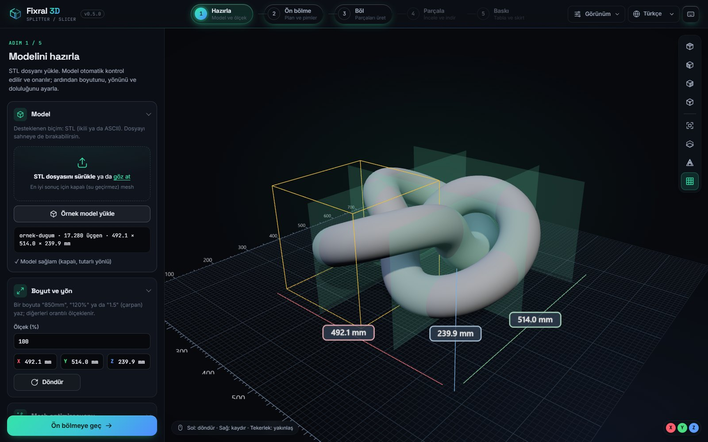
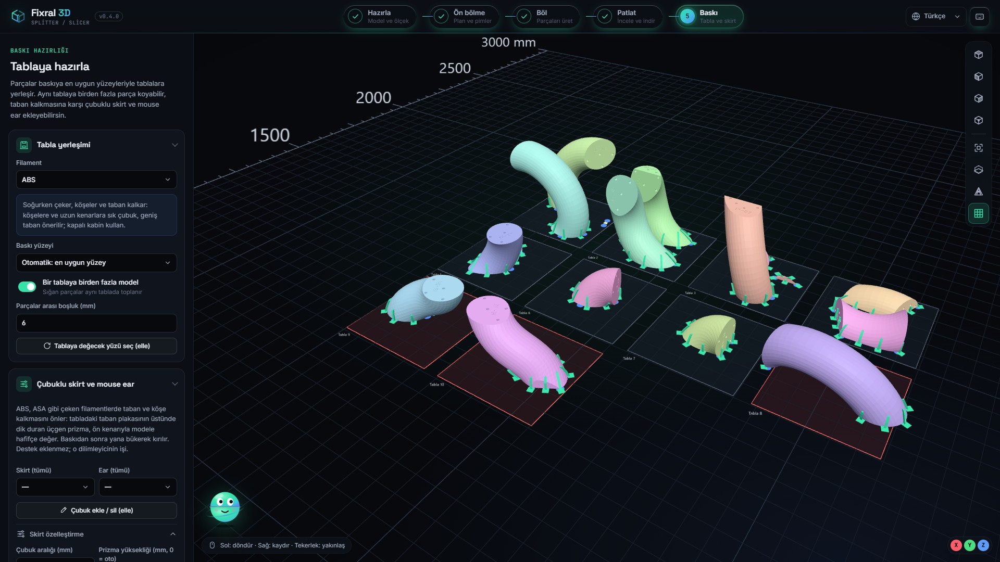
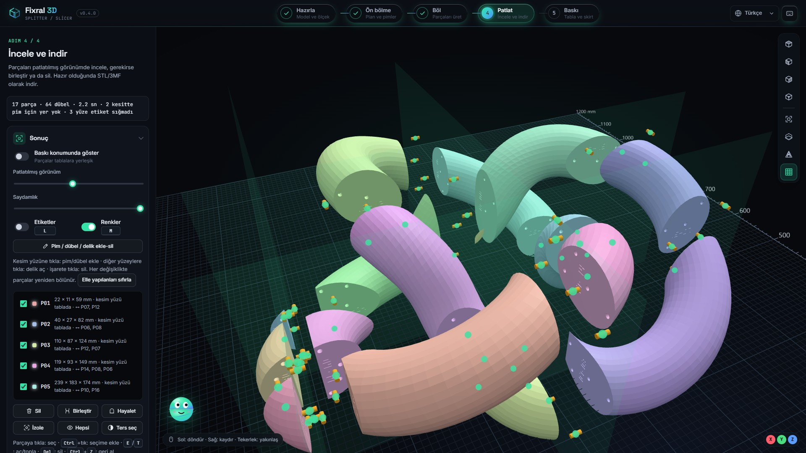
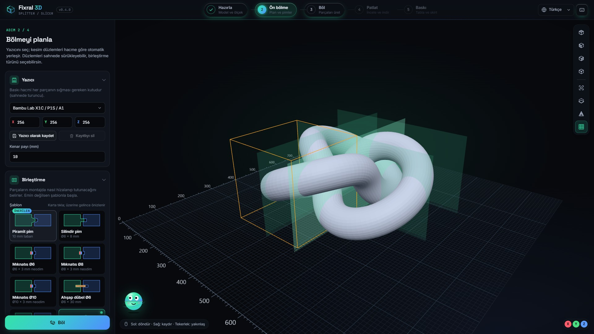
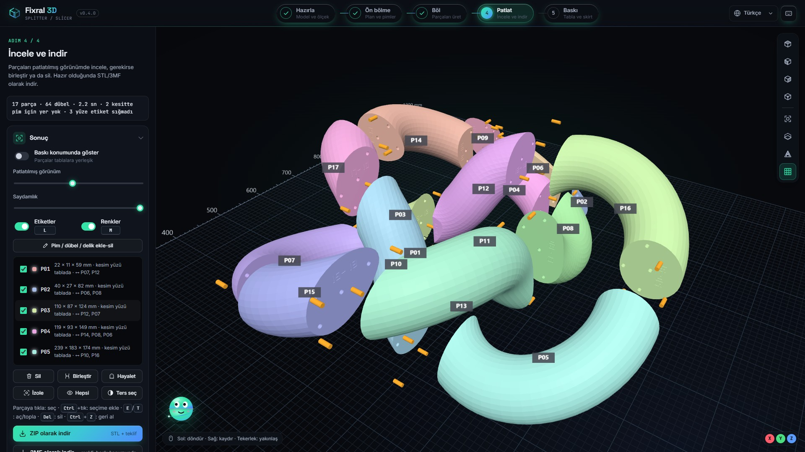
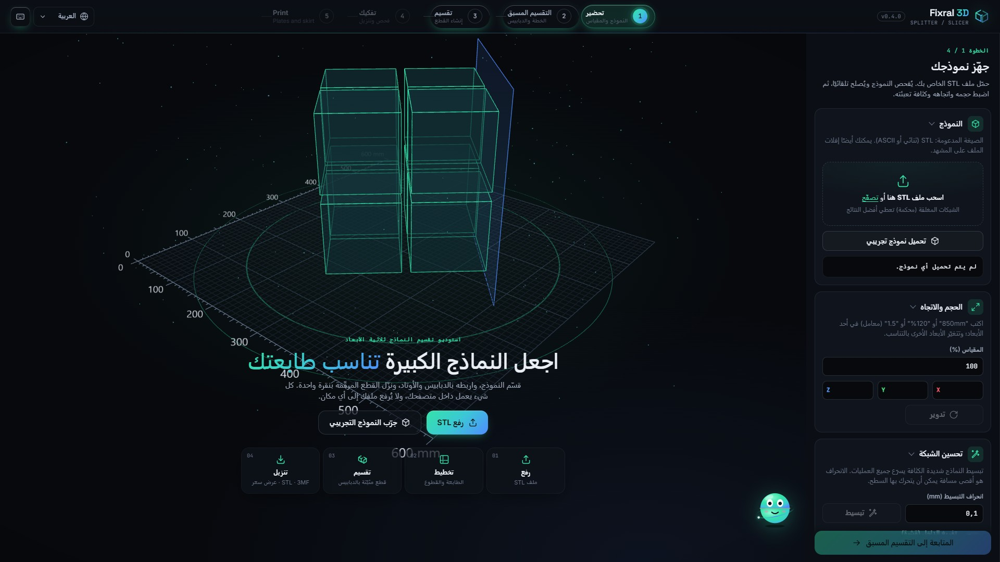

# Fixral 3D Splitter / Slicer

**Büyük 3D modelleri yazıcına sığdır.** Ücretsiz, tarayıcıda çalışan 3D model bölme stüdyosu: STL modelini yazıcının baskı hacmine göre böl; pim, dübel, mıknatıs, ahşap kavela, kırlangıç kuyruğu ya da bindirmeyle birleştir; numaralı parçaları baskıya hazır indir.

**Fit oversized 3D models on your printer.** A free, in-browser 3D model splitter: cut STL files to your build volume, join them with pins, dowels, magnets, dovetails or lap joints, and export numbered, print-ready parts.

### [▶ Canlı uygulamayı aç / Open the live app](https://fixral3d.github.io/fixral-3d-splitter/)

---

## Neden Fixral?

- **Kurulum yok, hesap yok:** Bağlantıyı aç ve kullan. Bilgisayar, tablet ya da telefonda çalışır.
- **Dosyan senin:** Model hiçbir sunucuya yüklenmez. Tüm geometri işlemleri tarayıcında, WebAssembly ile yapılır.
- **Baskıya hazır sonuç:** Parçalar baskı konumuna döndürülür, numaralanır ve birleşecekleri parçanın numarası kesim yüzüne yazılır.
- **10 dil ve konuşan asistan:** Arayüz ve sesli rehber, seçtiğin dilde.

## Nasıl çalışır?

| Adım | Ne yapar? |
|---|---|
| **1 · Hazırla** | STL'i sürükle. Otomatik mesh onarımı, sadeleştirme, ölçekleme (`850mm`, `120%`, `1.5`), döndürme, içini boşaltma. |
| **2 · Ön bölme** | Yazıcını seç (Bambu Lab, Prusa, Creality, Elegoo ya da özel ölçü). Kesim düzlemleri otomatik yerleşir; sürükle ya da eğri kesim çiz. |
| **3 · Böl** | Parçalar ve bağlantılar arka planda saniyeler içinde üretilir. |
| **4 · Parçala** | Parçaları ayrık görünümde incele, birleştir, sil; kesim yüzüne pim ya da dübel ekle. ZIP veya 3MF olarak indir. |
| **5 · Baskı** | Parçalar en uygun yüzleriyle tablalara yerleşir; çubuklu skirt ve mouse ear eklenir; tabla başına tek STL ya da 3MF. |

## v0.5.0'da yeni

- **Stüdyo görünüm:** sinematik ton eşleme, sıcak ana ışık ile soğuk dolgu ve kenar ışığı, zemine ve parçaların birbirine düşen yumuşak gölgeler. Eğri yüzeyler pürüzsüz, keskin kenarlar net; seçili parçanın çevresinde kontur.
- **Görünüm menüsü (`V`):** paneli, adım açıklamalarını, Dot'u, ızgarayı, ölçüleri ve yazıcı hacmini göster ya da gizle; ışık, parlaklık, ışık yönü, gölge, arka plan, panel genişliği ve çözünürlüğü kendine göre ayarla.
- **Daha geniş çalışma alanı:** `P` ile paneli gizle ya da kenarından sürükleyerek genişlet; her adımın ana düğmesi panelin altında sabit.
- **Sahnede ölçüler** ve yeni kısayollar: `1`–`4` görünümler, `F` sığdır, `G` ızgara, `X` kesit, `W` tel kafes, `R` döndür, `Enter` böl.
- **Hakkında ve Neler yeni:** sürüm rozetine tıkla; sürüm notları uygulamanın içinde.

## Öne çıkan özellikler

### Yüzeyi izleyen çubuklu skirt
ABS, ASA, naylon ve PC gibi çeken filamentlerde taban ve köşe kalkmasına karşı: tabladaki taban plakasının üstünde duran üçgen prizma modele hafifçe değer ve oval, eğimli yüzeylerde yüzeyin açısına göre eğilir. Baskıdan sonra yana bükerek kırılır. 8 filament profili (PLA, PETG, ABS, ASA, TPU, PA, PC, PLA-CF) hazır ölçülerle gelir.

### Kesitin şeklini izleyen bağlantılar
Pim, dübel, mıknatıs ve kırlangıç kuyruğu noktaları kesit boyunca, kalın bölgelere yakın ve aralıklı dağılır. Kesim yüzüne tıklayarak elle pim ya da dübel ekle; her noktanın çapı, boyu ve tipi ayrı ayarlanır.

### Canlı önizlemeli birleştirme şablonları
Piramit pim, silindir pim, Ø6/Ø8/Ø10 neodim mıknatıs, Ø6/Ø8 ahşap kavela, kırlangıç kuyruğu ve bindirme. Kartın üzerine gelince parçaların nasıl birleştiği canlı gösterilir; satın alınacak parça da yazılır.

### Numaralı parçalar
Kesim yüzlerine oyulan `03-07` etiketi: bu yüz P03'e ait ve P07 ile birleşir. Montajda kaybolmak yok.

### Konuşan asistan Dot ve 10 dil
Dot seçtiğin dilde sesli anlatım yapar, 16 adımlık rehberli tur verir ve "bu adımda ne yapmalıyım?" sorusunu yanıtlar. Arayüz Türkçe, English, Deutsch, 中文, 日本語, 한국어, العربية (sağdan sola), Français, Italiano ve Español dillerinde.

### Dahili fiyat teklifi
Filament, baskı süresi, malzeme, makine saati, montaj, hazırlık ve kâr payıyla tahmini teklif. ZIP içinde yazdırılabilir teklif ve montaj kılavuzu (`teklif.html`) gelir.

### Diğerleri
Eğri kesim çizme · akıllı seç & ayır (kulak, burun gibi detaylar) · kesim optimizasyonu (ince şerit bırakmaz) · içini boşaltma ve kesimlere otomatik dolu bölme · kesit ve tel kafes görünümü · büyüyen ızgara ve mm cetveli · STL, 3MF ve ZIP dışa aktarma.

## Dil bağlantıları

[Türkçe](https://fixral3d.github.io/fixral-3d-splitter/?lang=tr) ·
[English](https://fixral3d.github.io/fixral-3d-splitter/?lang=en) ·
[Deutsch](https://fixral3d.github.io/fixral-3d-splitter/?lang=de) ·
[中文](https://fixral3d.github.io/fixral-3d-splitter/?lang=zh) ·
[日本語](https://fixral3d.github.io/fixral-3d-splitter/?lang=ja) ·
[한국어](https://fixral3d.github.io/fixral-3d-splitter/?lang=ko) ·
[العربية](https://fixral3d.github.io/fixral-3d-splitter/?lang=ar) ·
[Français](https://fixral3d.github.io/fixral-3d-splitter/?lang=fr) ·
[Italiano](https://fixral3d.github.io/fixral-3d-splitter/?lang=it) ·
[Español](https://fixral3d.github.io/fixral-3d-splitter/?lang=es)

---

## English

**Fixral 3D Splitter / Slicer** splits oversized STL models to fit your 3D printer's build volume, entirely in your browser. No install, no account, and your file never leaves your computer: all geometry runs locally with WebAssembly.

- **Auto split** by printer profile (Bambu Lab, Prusa, Creality, Elegoo or custom), with cut optimization, draggable cut planes and freehand curved cuts
- **Joints:** pyramid or cylinder pins, separate dowels, neodymium magnet pockets, wooden dowels, dovetails and lap joints, placed along the shape of each cross-section
- **Model prep:** automatic mesh repair, simplification, scaling, rotation, hollowing with solid bulkheads at cuts, smart select & extract
- **Numbered parts** with engraved `03-07` mating labels and automatic print orientation
- **Print step:** plate layout, best print face per part, surface-following anchored skirt and mouse ears, 8 filament profiles
- **Export:** STL (ZIP), colored 3MF, per-plate STL, printable quote and assembly guide
- **Built-in quote:** filament, print time, machine, assembly, setup and margin
- **Dot**, a talking assistant with a 16-step guided tour, in 10 languages including right-to-left Arabic
- **New in v0.5.0:** studio lighting with soft shadows and a selection outline, a View menu (`V`) to show or hide panels and tune light, shadows and background, a hideable and resizable side panel, on-scene dimensions, new shortcuts, and an About dialog with release notes

**[▶ Open the live app](https://fixral3d.github.io/fixral-3d-splitter/?lang=en)**

---

Bu depo yalnızca canlı sitenin derlenmiş dosyalarını barındırır; kaynak kodu paylaşılmamaktadır.
This repository only hosts the built files of the live site; the source code is not public.

**Fixral 3D Splitter / Slicer v0.5.0** · [fixral.com](https://fixral.com) · [fixral3d@gmail.com](mailto:fixral3d@gmail.com)

© 2026 Fixral. Tüm hakları saklıdır. All rights reserved.
